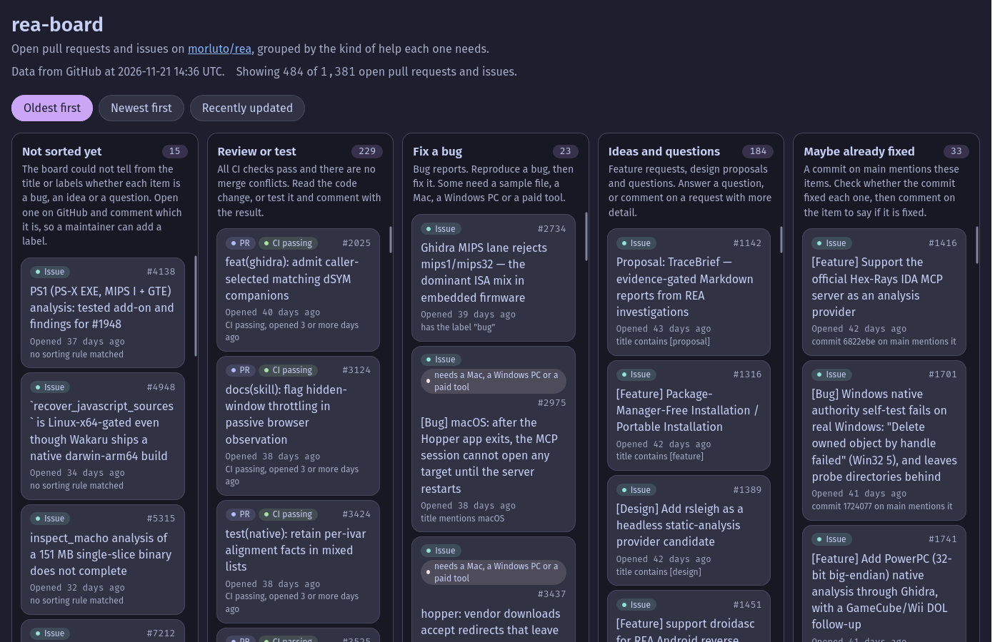

# rea-board

[](https://github.com/CassieFox23/rea-board/actions/workflows/ci.yml)

Open pull requests and issues on morluto/rea, sorted by the help each one needs.

**[See the board](https://cassiefox23.github.io/rea-board/)** (updated every 3 hours)

## What it is for

[REA](https://github.com/morluto/rea) is an open-source tool for reverse engineering with AI agents. It has many open pull requests and issues, and it is hard to see where help is wanted.

This board sorts them with a script and builds one static web page of five columns of cards. The board uses no AI model. It reads public data only, and it never writes anything to GitHub.

rea-board is an independent project. REA's maintainers do not run it. It is made by Cassie_Fox, who contributes to REA. It is not an official REA project.

It was built with help from Claude, an AI model. The board itself uses no AI. See [AI_POLICY.md](AI_POLICY.md).



## The columns

| Column | What it holds |
|---|---|
| Not sorted yet | Issues that the title and labels do not put in a column |
| Review or test | Pull requests where all checks pass and there are no merge conflicts |
| Fix a bug | Bug reports. Some need a sample file, a Mac, a Windows PC or a paid tool to test |
| Ideas and questions | Feature requests, design proposals and questions |
| Maybe already fixed | Items that a commit on REA's main branch mentions |

Buttons above the board sort the cards in every column: oldest first, newest first or recently updated.

The board shows fewer items than are open, because these groups do not get a card:

- pull requests that wait for their author
- pull requests with no new commits for 14 days or more
- pull requests by the maintainers or by a bot
- issues that are part of the maintainers' plan
- issues that an open pull request already fixes

"Maybe already fixed" needs a local copy (mirror) of REA to read the commits from the last 90 days. The hosted board makes one on every update. If you run the board yourself without a mirror, this column is empty.

## Run it yourself

You only need this to change the board, or to get data newer than the last update.

### Needs

- Python 3.11 or newer
- The [GitHub CLI](https://cli.github.com/) (`gh`), logged in to GitHub
- Optional: `git` and a bare clone (mirror) of morluto/rea, for the "Maybe already fixed" column

### Install

There is nothing to install. Clone the repository:

```sh
git clone https://github.com/CassieFox23/rea-board.git
cd rea-board
```

### Use

Run the commands from the repository folder.

| Command | What it does |
|---|---|
| `python3 -I pull.py` | downloads every open pull request and issue, sorts them and builds the page |
| `python3 -I page.py --board data/board.json --out data/board.html` | builds the page again from a saved board, without internet |
| `python3 -I lanes.py --board data/board.json` | counts a saved board, without internet |

`-I` tells Python to ignore your own Python settings.

The files go in the `data/` folder: `board.json`, `board.prev.json` (the board before), `board.html` and `stats.tsv` (the counts from each run). Open `board.html` in any browser.

To change the data folder or to use a mirror, copy `config.example.json` to `config.json` and edit it. `data_dir` is the data folder. `mirror` is the path to the bare clone. To use a config file somewhere else, set the environment variable `REA_BOARD_CONFIG` to its path.

The config file can also replace REA's own lists: `maintainers`, `bot_names`, `plan_authors` and `unsorted_labels`, each a list of names, and `main_since`, the first day of commits the mirror reads (a date like 2026-01-31; the default is 90 days back). The defaults are at the top of `conf.py`, and you should not need to change them. The repository is always morluto/rea.

### Tests

```sh
python3 -I -m unittest discover -s tests -p 'test_*.py'
```

The tests run without internet and need no config file.

## Roadmap

What may come next is in [ROADMAP.md](ROADMAP.md). What changed is in [CHANGELOG.md](CHANGELOG.md).

## Help

Open a [GitHub issue](https://github.com/CassieFox23/rea-board/issues). For a security problem, read [SECURITY.md](SECURITY.md) and do not open an issue.

A card is a best guess: read [DISCLAIMER.md](DISCLAIMER.md). What the board sends, and to whom, is in [PRIVACY.md](PRIVACY.md).

## Contributing

Read [CONTRIBUTING.md](CONTRIBUTING.md) and [AI_POLICY.md](AI_POLICY.md) first.

## Credits

- [GitHub CLI](https://cli.github.com/) (MIT), which the board uses to read GitHub
- [Contributor Covenant](https://www.contributor-covenant.org/) 2.1, the source of the [Code of Conduct](CODE_OF_CONDUCT.md)
- [Catppuccin](https://catppuccin.com/) (MIT), the colours of the page
- [GitHub Pages](https://pages.github.com/), which hosts the board

## Licence

GPL-3.0. Copyright 2026 Cassie_Fox. See [LICENSE](LICENSE).
